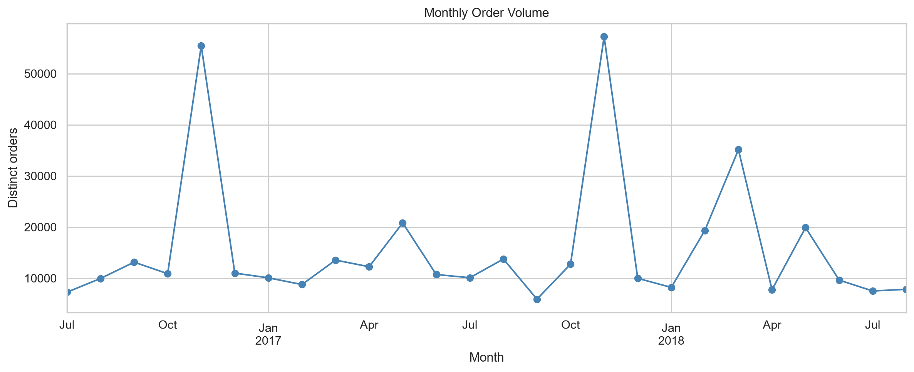
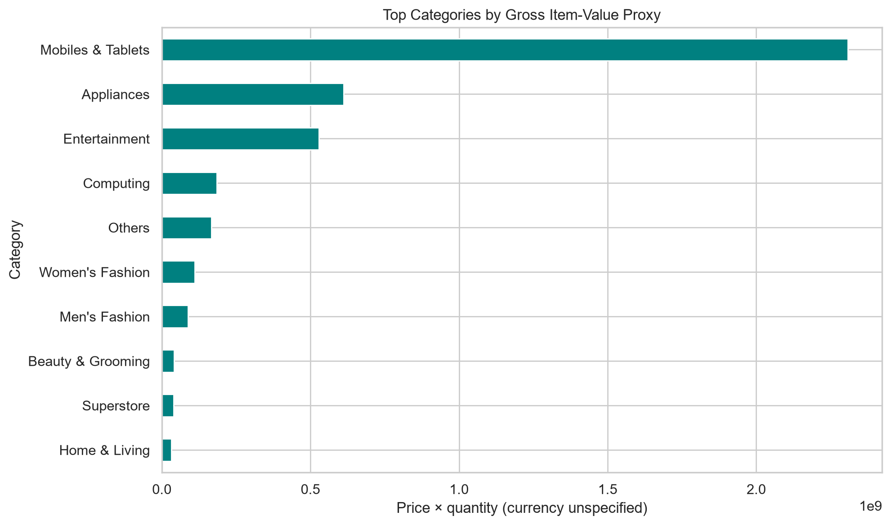
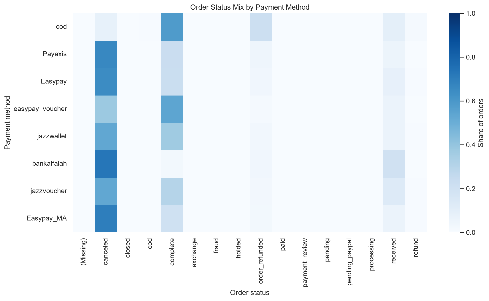

# Pakistan E-commerce Dataset Analysis

An end-to-end, CPU-friendly analysis of the Pakistan Largest E-commerce Dataset. The project covers data preprocessing, exploratory analysis, sales and customer trends, and an order-cancellation prediction baseline.

## Project files

- [`Pakistan_Ecommerce_Analysis.ipynb`](./Pakistan_Ecommerce_Analysis.ipynb) — preprocessing and analysis workflow.
- [`requirements.txt`](./requirements.txt) — Python dependencies.
- [`plots/`](./plots/) — exported figures used below.

Repository layout:

```text
.
├── .gitignore
├── Pakistan_Ecommerce_Analysis.ipynb
├── README.md
├── requirements.txt
└── plots/
```

The source dataset is not included. `DATASET/` and raw CSV files are excluded by `.gitignore`; obtain the dataset from its original provider and keep it local.

## Objective

Understand order demand, product/category performance, payment behavior, cancellations and refunds, then establish a practical baseline for identifying cancellation risk.

## Tech stack

- Python 3.12
- pandas and NumPy for data processing
- Matplotlib and seaborn for visualization
- scikit-learn and XGBoost for modeling
- Jupyter Notebook for the analysis workflow

## Dataset and preprocessing

The supplied CSV contains 1,048,575 physical rows, including 464,051 blank padding rows. After removing blank rows, the analysis has 584,524 item-level rows representing 408,782 distinct orders. Blank `Unnamed` columns are excluded, selected string fields are stored as categorical data, and date fields are parsed before calendar features are created.

Order totals, payment method, and status were consistent across item rows for each order in the EDA checks. The status field nevertheless contains unusual values such as `cod`; confirm status definitions before using them as business outcomes.

## Methodology

1. **Preprocessing:** memory-conscious CSV loading, removal of blank padding, date parsing, missing-value summaries, and anomaly checks.
2. **EDA:** order-level payment/status distributions and item-level price, quantity, and discount distributions. IQR outliers are reported, not automatically dropped.
3. **Trend analysis:** monthly/weekday order patterns, category gross item-value proxies, cancellation/refund rates, customer repeat behavior, and payment outcome comparisons.
4. **Prediction:** CPU-based XGBoost with one-hot categorical features and calendar features. The chronological test set is held out by order date.

## Findings

- **Seasonality:** November was the busiest complete month in the dataset: 57,244 orders in November 2017 and 55,450 in November 2016. The busiest dates, November 25, 2016 and November 24, 2017, align with Black Friday periods; campaign records would be needed to confirm the cause.
- **Weekday demand:** Friday had 89,704 orders, compared with 61,377 on Thursday and 40,083 on Sunday.
- **Category value proxy:** Mobiles & Tablets led with approximately 2.31 billion in `price × quantity`, followed by Appliances (612 million) and Entertainment (528 million). This is not profit or net revenue; costs are unavailable and the source currency is unspecified.
- **Category outcomes:** “Others” had a 62.87% item-row cancellation rate. Men’s Fashion had an 18.34% item-row refund rate. These categories merit investigation, but rates are not proof of a cause.
- **Payment outcomes:** COD accounted for 182,449 orders; its cancellation rate was 7.88% and refund rate was 23.69%. Some digital methods had much higher cancellation rates, including Bank Alfalah (72.88%) and Payaxis (66.02%). These associations may reflect differences in customers, order mix, or status quality.
- **Customer behavior:** 46.03% of customers with an identified customer ID had more than one recorded order. No geographic fields were present.

### Cancellation model

The target is `canceled` (positive class) versus the completed-like statuses `complete`, `received`, and `paid`. Refunds and ambiguous statuses are excluded, leaving 354,258 eligible orders. The test period begins at the chronological split date of March 14, 2018.

| Metric | Test result |
| --- | ---: |
| Accuracy | 0.7099 |
| Precision (canceled) | 0.7009 |
| Recall (canceled) | 0.8381 |
| F1-score (canceled) | 0.7634 |
| ROC-AUC | 0.7462 |

Confusion matrix, rows = actual and columns = predicted (`completed-like`, `canceled`):

|  | Predicted completed-like | Predicted canceled |
| --- | ---: | ---: |
| Actual completed-like | 17,504 | 14,451 |
| Actual canceled | 6,539 | 33,861 |

The model catches about 84% of canceled orders at this threshold, but also flags 14,451 completed-like orders as cancellations. Treat it as a prioritization aid for low-cost review or customer confirmation—not as an automatic order-cancellation system. Payment method dominates the model's feature importance; importance indicates predictive association, not causation.

## Visualizations

### Order volume



### Category gross item-value proxy



### Order status by payment method



Other EDA figures, including price/quantity outliers and payment distributions, are saved in [`plots/`](./plots/).

## Business recommendations

1. **Investigate payment funnels:** audit authorization failures, payment confirmation, and customer/order mix for digital methods with high cancellation rates. Run controlled tests before attributing the difference to the method itself.
2. **Review high-risk categories and catalog quality:** investigate cancellation and refund drivers in “Others,” Entertainment, and fashion categories; check stock accuracy, product descriptions, and return reasons.
3. **Plan for demand peaks:** prepare inventory, support, and fulfillment capacity for Fridays and November promotional periods; validate future campaign timing against actual promotion calendars.
4. **Use cancellation risk carefully:** pilot the model for targeted confirmation or low-cost retention outreach. Tune the decision threshold against intervention cost and validate on a later time period before operational use.
5. **Strengthen repeat-customer retention:** test loyalty and service-recovery campaigns for repeat customers while tracking cancellations and refunds, not just order volume.

## Run locally

From the project root in PowerShell, obtain the source CSV from its original provider and place it at `DATASET/Pakistan Largest Ecommerce Dataset.csv`. Then run:

```powershell
New-Item -ItemType Directory -Force DATASET | Out-Null
py -3.12 -m venv .venv
.\.venv\Scripts\Activate.ps1
python -m pip install -r requirements.txt
```

Open `Pakistan_Ecommerce_Analysis.ipynb` in VS Code, select the `.venv` Python environment as the notebook kernel, and run the cells in order. The notebook reads `DATASET\Pakistan Largest Ecommerce Dataset.csv` relative to the project root and writes PNG figures to `plots\`.

## Limitations

- The dataset has no product cost/margin fields, currency label, or geographic fields; profitability, currency conversion, and location analysis are not available.
- Recorded order value includes multiple order statuses and should not be described as recognized revenue.
- Status values need business validation; the `cod` status label is suspicious. The model excludes refund and ambiguous outcomes, so it predicts cancellation only among the selected known outcomes.
- The category feature is the most frequent category in each order and simplifies multi-category baskets.
- Model performance is a time-based baseline, not a production guarantee. Validate label quality, calibrate the threshold, and evaluate against newer data before deployment.
